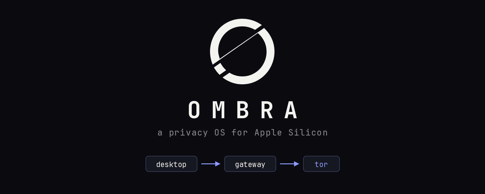
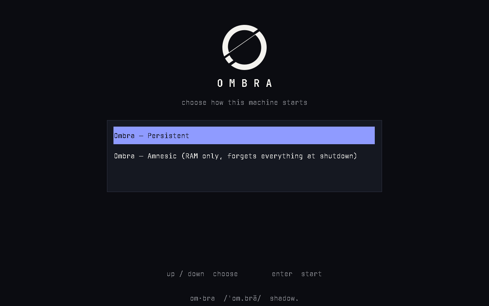
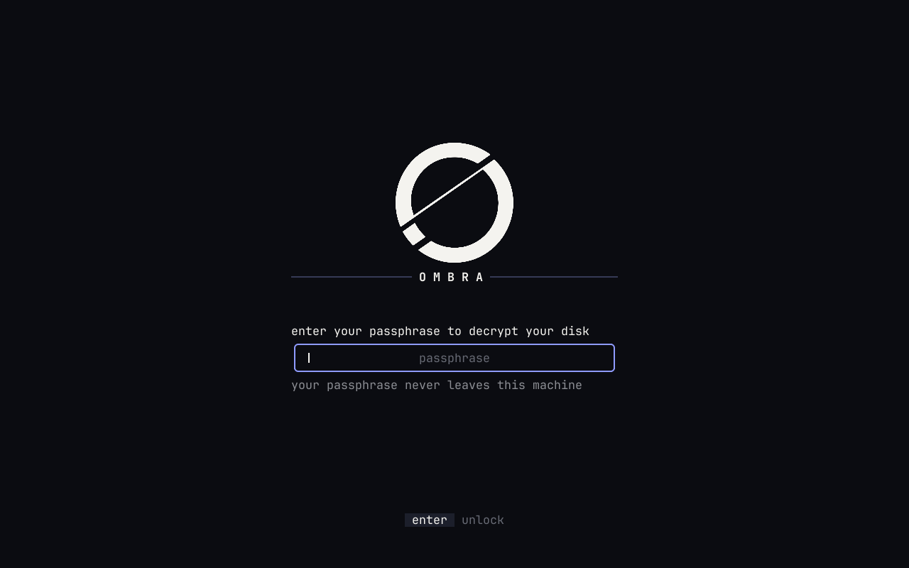
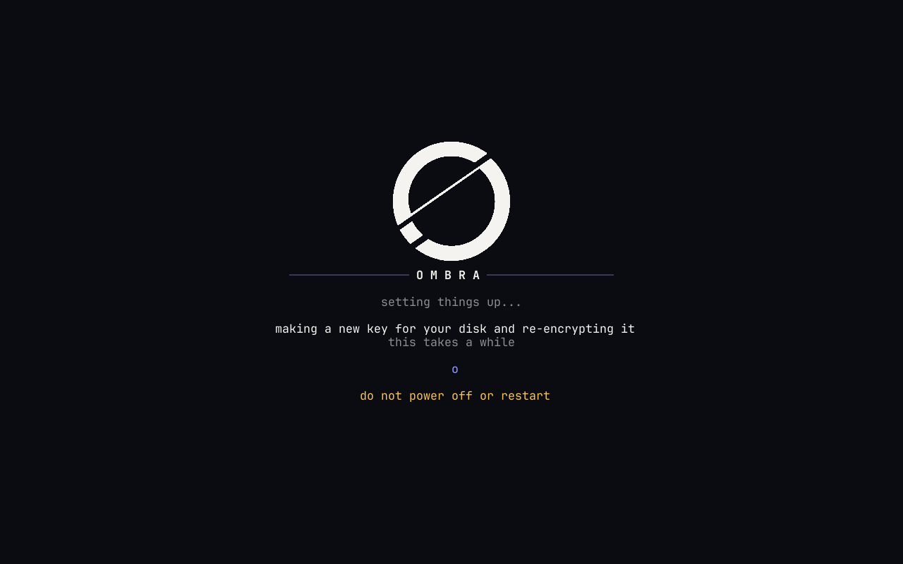
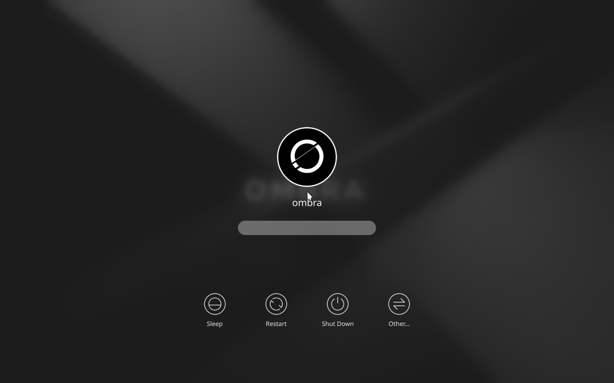
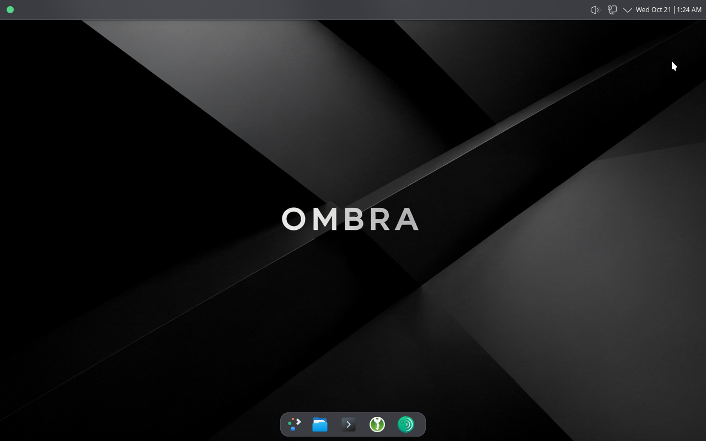
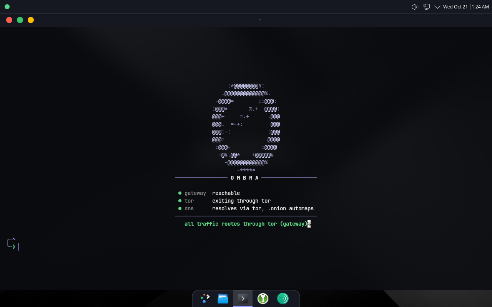

<p align="center">
  
</p>

<p align="center">
  <b>A headless Tor gateway and a KDE Plasma desktop whose only network path runs through Tor.</b>
</p>

<p align="center">
  <a href="https://ombra-os.org/install"><b>Download</b></a> ·
  <a href="https://ombra-os.org">Website</a> ·
  <a href="docs/INSTALL.md">Install</a> ·
  <a href="docs/DESIGN.md">Design</a> ·
  <a href="docs/THREAT_MODEL.md">Threat model</a> ·
  <a href="SECURITY.md">Security</a>
</p>

> om·bra /'om.brä/ · italian, noun / 1. shadow. / 2. this machine:
> everything it does online passes through tor. you were never here.

| Edition | What it is | Ships as |
|---|---|---|
| Two VMs (default) | Gateway VM + desktop VM: the hypervisor separates Tor's side from your apps | Prebuilt VM archives for Fusion and UTM |
| Single VM | One VM: the gateway runs as a container inside the desktop. Easier, weaker isolation ([comparison](docs/THREAT_MODEL.md#two-vms-vs-single-vm)) | An installer ISO for a VM you create; tested on Fusion, untested on UTM |

How to install either: [docs/INSTALL.md](docs/INSTALL.md). The rest of this page describes the two-VM edition unless it says otherwise.

## Features

- **Two machines, one way out:** the desktop has one NIC on a private link whose only route out is the gateway
- **Fail-closed:** if Tor is down, the desktop has no network at all
- **Amnesic or persistent:** you choose at every boot; nothing starts on its own
- **Encrypted at rest:** LUKS2 (argon2id) and encrypted swap on the desktop
- **No telemetry:** no analytics, no accounts, no exit IP shown or logged. The only automatic requests are a signed update check, a Tor exit check (the desktop status light, and the gateway console panel at each login), and a clock check, all through Tor and none carrying anything about you; the full list is in the [threat model](docs/THREAT_MODEL.md#designed-runtime-probes)
- **IPv6 off, generic identity, Tor-only DNS:** the clock starts from the Mac at boot and is corrected over Tor
- **Privacy applications included:** Tor Browser, KeePassXC, Kleopatra (OpenPGP), OnionShare, Electrum, Feather and SimpleX, all preset to use Tor
- **Native arm64:** built for Apple Silicon, no emulation
- **Pinned inputs:** the Debian installer, Tor Browser, Feather and SimpleX are pinned by hash; Debian packages are signed by Debian and every version in the image is recorded in `/usr/share/ombra/packages.txt`. Installing the two-VM archives downloads nothing; the single VM installer downloads Debian packages directly from Debian, not through Tor
- **Updates on request:** signed Ombra updates, and Debian's security updates when you press a button, both through Tor; nothing installs on its own

## Screens

<table>
  <tr>
    <td width="50%"><br><sub>Boot menu: Persistent or Amnesic</sub></td>
    <td width="50%"><br><sub>Disk unlock</sub></td>
  </tr>
  <tr>
    <td width="50%"><br><sub>First use: a new key for your disk</sub></td>
    <td width="50%"><br><sub>Login</sub></td>
  </tr>
  <tr>
    <td width="50%"><br><sub>Desktop, Tor status LED green</sub></td>
    <td width="50%"><br><sub>Connectivity panel</sub></td>
  </tr>
</table>

## Install

1. Download both VM archives (VMware Fusion `.vmwarevm.zip`, or UTM `.utm.zip`) and `SHA256SUMS.txt` from [ombra-os.org/install](https://ombra-os.org/install)
2. Verify:

   ```sh
   shasum -a 256 -c SHA256SUMS.txt --ignore-missing
   ```

   This proves the download is complete and undamaged, not who made it: the checksum file comes from the same site, and no signature for it is published yet
3. Unzip both archives and open them in VMware Fusion or UTM
4. Power on the gateway, then the desktop; choose **Persistent** on the desktop for first boot
5. Set your disk passphrase and password; the disk re-encrypts under a new key

Single VM edition: boot its ISO in a VM you create and answer two questions (password, disk passphrase); see [docs/INSTALL.md](docs/INSTALL.md#single-vm-installer-iso).

Details: [docs/INSTALL.md](docs/INSTALL.md)

| Requirement | Value |
|---|---|
| Host | Apple Silicon Mac with VMware Fusion or UTM 5.0.8+ |
| Download | About 7.3 GB (both machines) |
| Free disk | About 45 GB (5 GB gateway + 30 GB desktop, provisioned, plus the archives) |

## The two machines

| | ombra-gateway | ombra-desktop |
|---|---|---|
| Role | Tor router, fail-closed firewall, headless | KDE Plasma (X11) workstation |
| Base | Debian trixie, arm64 | Debian trixie, arm64 |
| Network | NAT upstream, Tor-only egress; private link to the desktop | One NIC on the private link; no other path |
| Disk | Amnesic or persistent | LUKS2 full-disk encryption, encrypted swap; amnesic or persistent |
| Resources | 512 MB RAM, 1 vCPU, 5 GB disk | 6 GB RAM, 4 vCPU, 30 GB disk |

## Boot modes

| Mode | Behavior |
|---|---|
| Amnesic | Runs from RAM over a read-only image; everything the guest writes is gone at shutdown. The Mac can still keep copies: suspended VM memory, the transfer disk, backups (see the [threat model](docs/THREAT_MODEL.md#host-residue)) |
| Persistent | Writes to disk; the desktop disk stays encrypted; first-time setup runs here |

## Compared

| | **Ombra** | Whonix | Tails |
|---|:---|:---|:---|
| **Design** | **Gateway VM + desktop VM** | Gateway VM + workstation VM | Single live OS |
| **Network path** | **One NIC on a private link; the only route is the gateway** | Workstation reaches the network only through the gateway | One OS; Tor enforced by firewall rules |
| **Desktop** | **KDE Plasma, themed, mouse-first** | Lightweight desktop; varies by release | GNOME |
| **Base** | **Debian 13 (trixie)** | Debian | Debian 13 (trixie) |
| **Apple Silicon** | **Yes, native arm64** | Not officially supported | No. x86-64 only |
| **Amnesic mode** | **Your choice at every boot** | Partial. Optional (live mode) | Yes. Always |
| **Disk encryption** | **LUKS2 on the desktop disk, inside the VM** | No. Not in its images; encrypt the host | Partial. Optional encrypted Persistent Storage |
| **Runs on** | **VMware Fusion or UTM** | VirtualBox, KVM, Qubes | Bare hardware |
| **Maturity** | **New, no independent audit** | Established | Established |

## Status

- Apple Silicon with VMware Fusion or UTM only; there is no x86 build
- Only the latest release is supported; earlier releases get no fixes and their images are not kept
- Tor Browser is the stable channel for linux-aarch64 (16.0.1), a newer and smaller platform than the x86 desktop builds; v1.1.0 carried the alpha 16.0a14
- The single VM edition is tested on VMware Fusion only; under UTM it is untested
- Debian security updates: user-started, from v1.2.0; v1.1.0 images do not have the action
- No Tor bridges or pluggable transports: your network can see that you use Tor, and Ombra does not work where Tor is blocked
- No independent security audit yet; read the [threat model](docs/THREAT_MODEL.md) before relying on it
- Report vulnerabilities through [SECURITY.md](SECURITY.md)

## Build from source

One guided command checks your Mac, installs missing tools, verifies the pinned downloads, builds, and creates both VMs (in a clone of this repository, `bash scripts/build.sh --edition single` builds the single VM installer ISO instead):

```sh
curl -fsSL https://ombra-os.org/build.sh | bash
```

Read the script first: [`scripts/build.sh`](scripts/build.sh). Manual route: [docs/INSTALL.md](docs/INSTALL.md).

| Tool | Version |
|---|---|
| Rust | pinned in `core/rust-toolchain.toml` |
| `xorriso`, `python3` | any recent |
| Free disk | about 50 GB |

## Documentation

| Document | Contents |
|---|---|
| [Design](docs/DESIGN.md) | Architecture and invariants |
| [Threat model](docs/THREAT_MODEL.md) | What Ombra defends against, and what it does not |
| [Install](docs/INSTALL.md) | Both editions: release images, the single VM ISO, and build from source |
| [Updates](docs/UPDATES.md) | Ombra updates, Debian security updates, rollback |
| [Third-party licenses](docs/THIRD_PARTY_LICENSES.md) | Vendored assets and linked crates |
| [Security policy](SECURITY.md) | How to report |

## License

GPL-3.0-or-later. Copyright (C) 2026 Xen. See [LICENSE](LICENSE).

## Support Ombra

Ombra is free to use. Every release is free to download, build and run, with no account and no payment. To support the project, see [ombra-os.org/support](https://ombra-os.org/support).
