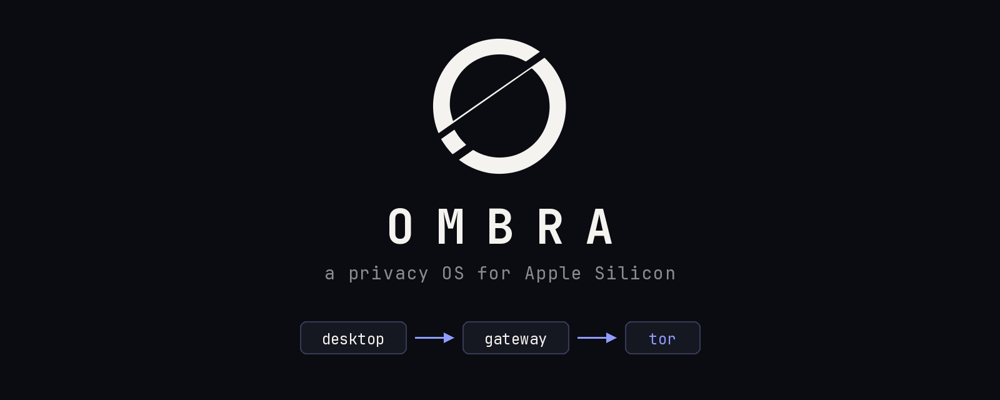
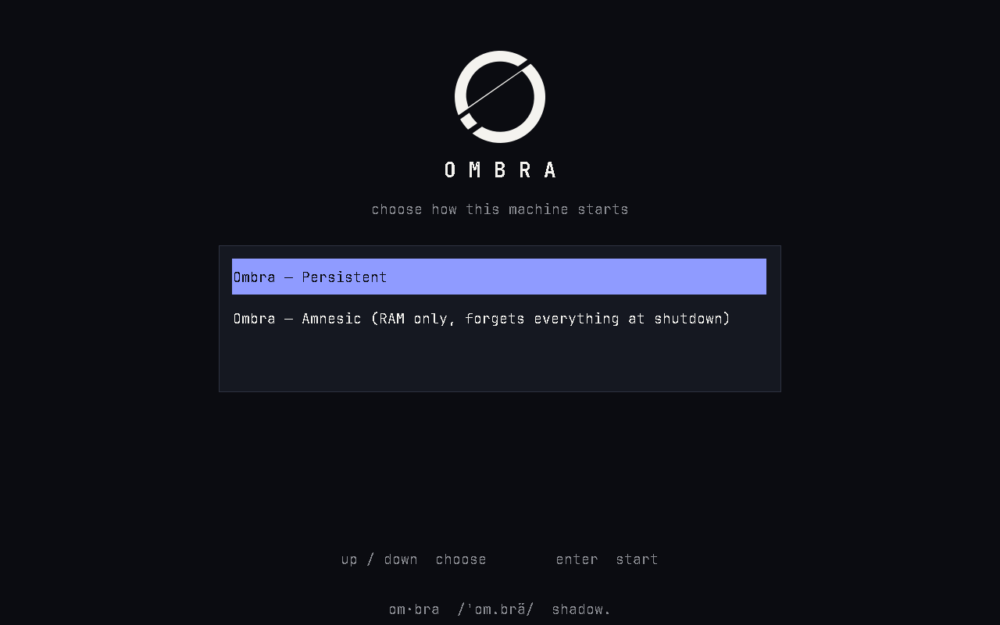
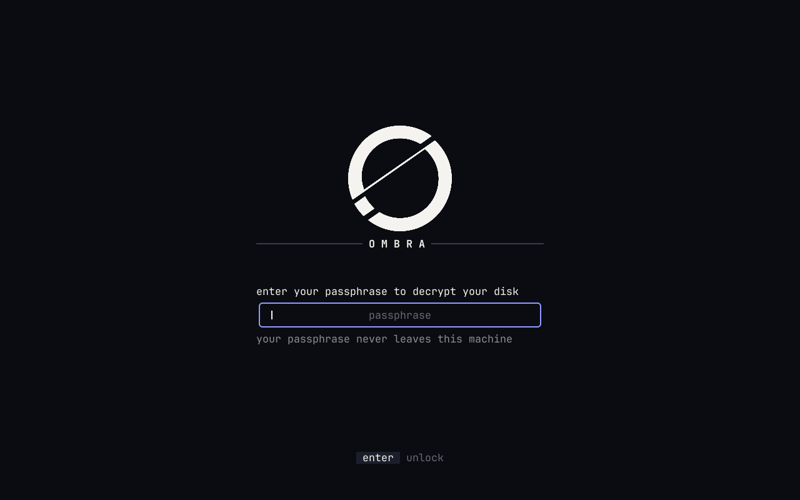
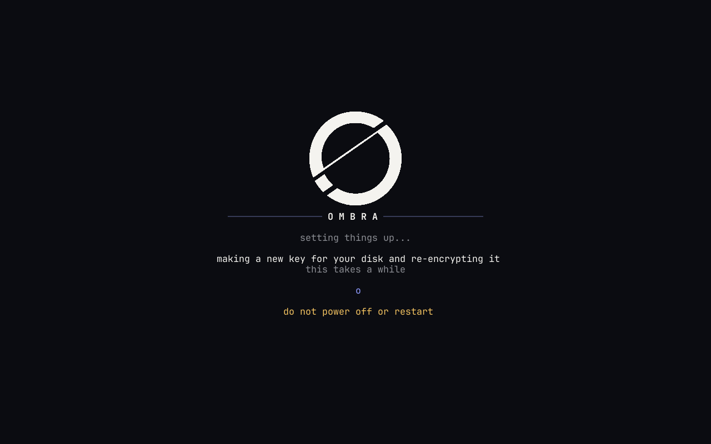
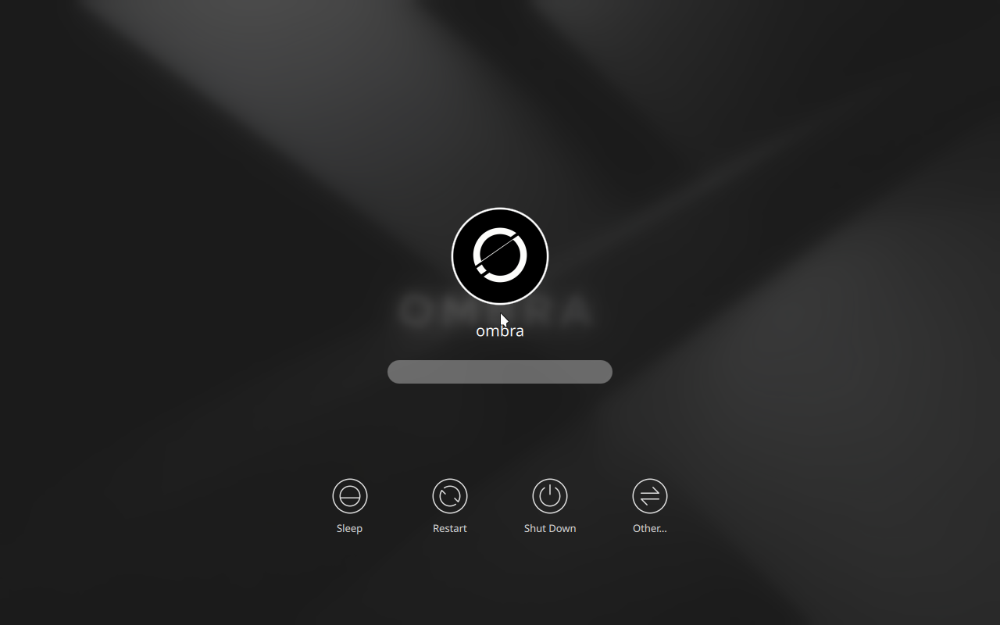
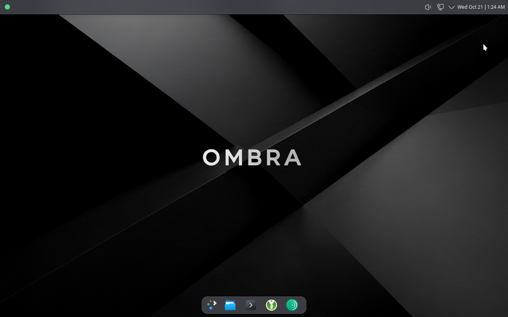
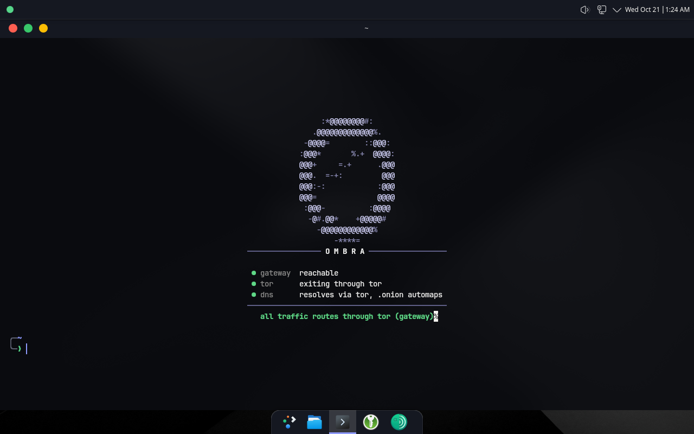

<p align="center">
  
</p>

<p align="center">
  <b>A headless Tor gateway and a KDE Plasma desktop whose only network path runs through Tor.</b>
</p>

<p align="center">
  <a href="https://ombra-os.org/install"><b>Download</b></a> ·
  <a href="https://ombra-os.org">Website</a> ·
  <a href="docs/INSTALL.md">Install</a> ·
  <a href="docs/DESIGN.md">Design</a> ·
  <a href="docs/THREAT_MODEL.md">Threat model</a> ·
  <a href="SECURITY.md">Security</a>
</p>

> om·bra /'om.brä/ · italian, noun / 1. shadow. / 2. this machine:
> everything it does online passes through tor. you were never here.

## Features

- **Two machines, one way out:** the desktop has one NIC on a private link whose only peer is the gateway
- **Fail-closed:** if Tor is down, the desktop has no network at all
- **Amnesic or persistent:** you choose at every boot; nothing starts on its own
- **Encrypted at rest:** LUKS2 (argon2id) and encrypted swap on the desktop
- **No telemetry:** no update checks, no phoning home, no exit IP shown or logged
- **IPv6 off, generic identity, Tor-only DNS and time**
- **Native arm64:** built for Apple Silicon, no emulation
- **Pinned supply chain:** every download is pinned and hash-checked; nothing is fetched at install or boot

## Screens

<table>
  <tr>
    <td width="50%"><br><sub>Boot menu: Persistent or Amnesic</sub></td>
    <td width="50%"><br><sub>Disk unlock</sub></td>
  </tr>
  <tr>
    <td width="50%"><br><sub>First use: a new key for your disk</sub></td>
    <td width="50%"><br><sub>Login</sub></td>
  </tr>
  <tr>
    <td width="50%"><br><sub>Desktop, Tor status LED green</sub></td>
    <td width="50%"><br><sub>Connectivity panel</sub></td>
  </tr>
</table>

## Install

1. Download both OVAs and `SHA256SUMS.txt` from [ombra-os.org/downloads](https://ombra-os.org/downloads)
2. Verify:

   ```sh
   shasum -a 256 -c SHA256SUMS.txt --ignore-missing
   ```
3. Import both OVAs into VMware Fusion
4. Power on the gateway, then the desktop; choose **Persistent** on the desktop for first boot
5. Set your disk passphrase and password; the disk re-encrypts under a new key

Details: [docs/INSTALL.md](docs/INSTALL.md)

| Requirement | Value |
|---|---|
| Host | Apple Silicon Mac, VMware Fusion |
| Download | 5.9 GB |
| Free disk | 40 GB recommended (5 GB gateway + 30 GB desktop, provisioned) |

## The two machines

| | ombra-gateway | ombra-desktop |
|---|---|---|
| Role | Tor router, fail-closed firewall, headless | KDE Plasma (X11) workstation |
| Base | Debian trixie, arm64 | Debian trixie, arm64 |
| Network | NAT upstream, Tor-only egress; private link to the desktop | One NIC on the private link; no other path |
| Disk | Amnesic or persistent | LUKS2 full-disk encryption, encrypted swap; amnesic or persistent |
| Resources | 512 MB RAM, 1 vCPU, 5 GB disk | 6 GB RAM, 4 vCPU, 30 GB disk |

## Boot modes

| Mode | Behavior |
|---|---|
| Amnesic | Runs from RAM over a read-only image; everything written is gone at shutdown |
| Persistent | Writes to disk; the desktop disk stays encrypted; first-time setup runs here |

## Compared

| | Ombra | Whonix | Tails |
|---|---|---|---|
| Design | Gateway VM + desktop VM | Gateway VM + workstation VM | Single live OS |
| Apple Silicon | Yes, native | Not officially supported | No |
| Amnesic mode | Choice at every boot | Optional (live mode) | Always |
| Persistent encrypted disk | Yes | Yes | Optional storage |
| Runs on | VMware Fusion | VirtualBox, KVM, Qubes | Bare hardware |
| Maturity | New, no independent audit | Established | Established |

## Status

- Apple Silicon and VMware Fusion only; there is no x86 build
- Only the latest release is supported; earlier releases get no fixes and their images are not kept
- Tor Browser is the alpha channel (16.0a13): the only channel with linux-aarch64 builds
- No independent security audit yet; read the [threat model](docs/THREAT_MODEL.md) before relying on it
- Report vulnerabilities through [SECURITY.md](SECURITY.md)

## Build from source

One guided command checks your Mac, installs missing tools, verifies the pinned downloads, builds, and creates both VMs:

```sh
curl -fsSL https://ombra-os.org/build.sh | bash
```

Read the script first: [`scripts/build.sh`](scripts/build.sh). Manual route: [docs/INSTALL.md](docs/INSTALL.md).

| Tool | Version |
|---|---|
| Rust | pinned in `core/rust-toolchain.toml` |
| `xorriso`, `python3` | any recent |
| Free disk | about 45 GB |

## Documentation

| Document | Contents |
|---|---|
| [Design](docs/DESIGN.md) | Architecture and invariants |
| [Threat model](docs/THREAT_MODEL.md) | What Ombra defends against, and what it does not |
| [Install](docs/INSTALL.md) | OVA quick start and build from source |
| [Third-party licenses](docs/THIRD_PARTY_LICENSES.md) | Vendored assets and linked crates |
| [Security policy](SECURITY.md) | How to report |

## License

GPL-3.0-or-later. Copyright (C) 2026 Xen. See [LICENSE](LICENSE).
